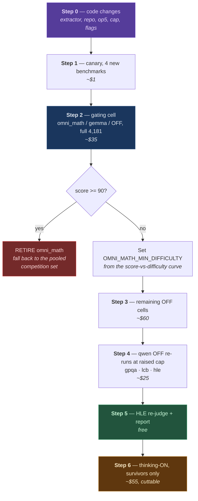

# Step 1 (revised) — Post-Screen Benchmark Decisions

**Status:** decided, awaiting the second screening run
**Last updated:** 2026-09-05
**Supersedes:** the benchmark list in [`benchmarks_decisions.md`](benchmarks_decisions.md); the protocol and rationale in that document still stand
**Code:** [`screening/`](../screening/) · **Outputs:** [`benchmarks/`](../benchmarks/)

---

## 1. Why this document exists

[`benchmarks_decisions.md`](benchmarks_decisions.md) was written before any API call had been
made. The first live run has now completed, and it retired or blocked four of the eight
screened benchmarks — including the whole of the mathematics domain.

This document records what the run found, which benchmarks replace the casualties, why
those replacements and not others, and the exact sequence in which the second screen
should be executed.

The protocol from the original document is unchanged: same gate, same thinking-OFF
fairness rule, same Wilson intervals, same cost-before-compute principle. Only the
benchmark list moves.

---

## 2. What the first run found

Sixteen of the planned thirty-two cells completed — the thinking-OFF arm only.

| Benchmark | n | gemma OFF | qwen OFF | Wilson 95% | Verdict | Action |
|---|---|---|---|---|---|---|
| aime25 | 30 | 96.7 | 90.0 | [83.3, 99.4] | UNDECIDED | **discard** |
| math500 | 500 | 96.2 | 83.4 | [94.1, 97.6] | RETIRE | **discard** |
| medqa | 300 | 92.3 | 90.0 | [88.8, 94.8] | UNDECIDED | **discard** |
| aime26 | 30 | 90.0 | 90.0 | [74.4, 96.5] | UNDECIDED | **discard** |
| mbppplus | 378 | 81.7 | 79.1 | [77.5, 85.3] | RETAIN | keep (anchor) |
| lcb | 1055 | 80.8 | 63.7 | [78.3, 83.0] | RETAIN | keep (anchor) |
| gpqa | 198 | 74.2 | 68.2 | [67.7, 79.8] | RETAIN | keep (anchor) |
| hle | 2158 | 11.0 | 4.2 | [9.7, 12.4] | RETAIN | keep (subset) |

Four survivors against a `MIN_SURVIVING_BENCHMARKS` of 4 — the stop rule was cleared
with zero slack, against Step 1's target of six to eight.

### 2.1 A finding that belongs in the write-up

An untrained Gemma 4 31B, thinking disabled, beats the paper's **best full recursive
system** on every benchmark for which a published figure exists:

| | RecursiveMAS (published) | Gemma 4 31B, untrained, OFF |
|---|---|---|
| MATH500 | 88.0 | **96.2** |
| AIME2026 | 86.7 | **90.0** |
| GPQA-Diamond | 66.2 | **74.2** |
| LiveCodeBench | 42.9 | **80.8** |
| MedQA | 79.3 | **92.3** |

This is expected at seven times the parameter count, and it is precisely why Research
Question 1 is worth asking. But it fixes what "continuity anchor" can mean: *same
dataset, same harness*, never *comparable absolute number*. Step 2's reproduction
targets remain valid because Step 2 runs the paper's original 3–4B roster; the Step 8
table cannot be read against the published one directly, and the methods section must
say so.

---

## 3. Discards, with reasons

### 3.1 math500 — saturated

96.2 with the entire interval [94.1, 97.6] above the gate. Only 19 of 500 items are
unsolved, so a one-point improvement would require solving 5 of them and the project's
half-point criterion 2.5 of them. Clean retirement; no further action.

### 3.2 aime25 and aime26 — unmeasurable at n=30

Both are marked UNDECIDED with the remedy *"the sample is too small to decide; run the
full set."* **That instruction cannot be followed.** AIME 2025 and AIME 2026 contain
exactly 30 problems each; `n=30` is already the full set. The verdict is terminal, not
a task, and `exclusions.md` must be corrected to say so.

The stronger reason is independent of saturation. **A 30-item benchmark has a
granularity of 3.33 points.** Every attainable score is a multiple of 1/30, so the
half-point effect the success criteria demand is not merely hard to detect — it is
unrepresentable on the scale. No token cap, seed or run count changes that.

**Recorded for the write-up:** re-scoring the cached generations item by item shows the
*problems* are not saturated at all.

| | pass@1 | pass@10 | never solved |
|---|---|---|---|
| aime25, gemma | 67.7 | 96.7 | 1/30 |
| aime26, gemma | 79.0 | 90.0 | 3/30 |

What saturates them is `pass@10` — the paper's protocol, which counts an item solved if
*any* of ten attempts succeeded. Ten attempts at a problem the model already solves 68%
of the time is close to a guarantee. The task retains headroom; the metric discards it.
This directly shapes the replacement design in §4.

### 3.3 medqa — resolvable, but not worth resolving

92.3 with [88.8, 94.8] straddling the gate. Unlike AIME the stated remedy is genuinely
actionable: screening used the 300-item subset shipped with the harness, and the real
test set holds 1,273 items.

It is not worth the ~$4. At 1,273 items holding 92.3 the interval becomes **[90.7,
93.6]** — wholly above the gate, so `_decide` returns RETIRE. The likeliest outcome of
paying is a tighter interval around the same number and a retirement anyway. Only 23 of
300 items are unsolved, capping any measurable architectural effect at 7.7 points.
Medicine is retained as a domain; MedQA is not retained as the instrument.

---

## 4. The replacement set

| Benchmark | Domain | n | old/new | Reason for choosing |
|---|---|---|---|---|
| **GPQA-Diamond** | science | 198 | old | Anchor. 74.2 with 25.8 points of headroom. Weakest instrument retained (±6.1) — kept for continuity, not leaned on. |
| **MBPP+** | code | 378 | old | Anchor. 81.7 with clean diagnostics (0.5% parse-fail, 0.5% truncation). Cheapest cell in the sweep. |
| **LiveCodeBench v1–v6** | code | 1,055 | old | Anchor. 80.8, largest paper benchmark retained; rolling releases resist contamination as models are retrained. |
| **HLE (text), frozen 500-item subset** | cross-domain | 500 | old | 11.0 — the only cross-domain set and by far the most headroom. Subset because the full 2,158 × 3 depths × 5 runs × 6 rows is ~194k judged generations in Step 8. |
| **Omni-MATH-2-Filtered**, difficulty-cut, **avg@k not pass@k** | mathematics | ~2,000–4,181 (see §6.2) | **new** | Restores mathematics, which is otherwise empty. Repaired 2026 edition; largest n of any candidate, which is what the half-point criterion requires. |
| **MedXpertQA (Text)** | medicine | 2,450 | **new** | Replaces MedQA. Hardest of 19 verifiable medical benchmarks in Medmarks (0.236 mean across 61 models vs MedQA's 0.784). MIT-licensed, ungated. |
| **BeyondAIME** | *control* | 100 | **new** | Not gated. Contamination and judge-independence control for Omni-MATH — see §5.1. |
| **Medbullets op4 / op5** | *control* | 308 × 2 | **new** | Not gated. Critic mechanism probe — see §5.2. |

Six gated benchmarks (target 6–8), three paper anchors (requirement ≥2), all domains
except search covered, plus two controls.

### 4.1 Why Omni-MATH-2, not the original Omni-MATH

`KbsdJames/Omni-MATH` (October 2024) was audited in
[arXiv:2601.19532](https://arxiv.org/abs/2601.19532), which found **647 problems
requiring edits (14.6%)** and **247 structurally incompatible with exact-answer
verification (5.6%)**: 115 requesting proofs, **61 referencing missing images**, 54
requiring estimation, 25 degenerate or duplicated. The missing-image items are
disqualifying here specifically, because Step 3 disables Gemma's vision path.

Use **[`martheballon/Omni-MATH-2`](https://huggingface.co/datasets/martheballon/Omni-MATH-2)**,
split `filtered` — 4,181 problems with those items removed and the LaTeX repaired.

Reported scores on it, judged properly (frontier models, thinking on):

| Model | Score |
|---|---|
| Gemini 3 Pro | 89.9 |
| Kimi K2 Thinking | 86.9 |
| GPT-5 | 84.5 |
| DeepSeek v3.2 | 83.0 |
| Claude Sonnet 4.5 | 79.3 |

Gemma 4 31B with thinking off will sit well below that band. Headroom is not in doubt.

### 4.2 Never use Omni-Judge

**Decision.** The Omni-MATH judge is prohibited. Pin a strong, recorded judge instead.

**Rationale.** The same audit found Omni-Judge **wrong in 96.4% of judge disagreements**,
its dominant failure being the equivalence-checking it exists to perform. Re-scoring
identical generations with a competent judge moved DeepSeek v3.2 from 77.45 to
**82.95** — a **5.5-point swing from the judge alone**, with rankings reshuffled.

This project measures effects of roughly half a point. A judge worth eleven times the
effect size is not a detail. Treat *(dataset, judge)* as one frozen unit, record it in
`manifest.json` beside the provider pins, and — because `--rescore-only` is free — score
once under a second judge and record the delta. A delta exceeding the effect size is a
measurement problem, not a result.

**This applies to HLE today.** HLE is already judged by `qwen/qwen3.8-2.4t-a95b`, which
is grading `qwen/qwen3.8-27b` — the same model family. Qwen scored *lower* than Gemma
(4.2 vs 11.0), so self-preference did not manifest, but the exposure is unaudited and
the re-judge costs nothing.

### 4.3 avg@k, not pass@k

**Decision.** Omni-MATH is scored as the mean of independent attempts, never as
"any attempt succeeded".

**Rationale.** §3.2 shows `pass@10` is what destroyed AIME. The inflation is severe and
applies to any difficulty:

| true per-attempt skill | pass@1 | pass@2 | pass@10 |
|---|---|---|---|
| 20% | 20.0 | 36.0 | **89.3** |
| 30% | 30.0 | 51.0 | **97.2** |
| 40% | 40.0 | 64.0 | **99.4** |
| 65% | 65.0 | 87.8 | **100.0** |

The `omni_math` spec currently carries `rollouts=10`. Left alone it would do to the
replacement exactly what it did to AIME, and less visibly — Omni-MATH's problems are
genuinely hard, so a 90 would look plausible rather than obviously broken.

Keep multiple rollouts in Step 8 (the five-run protocol needs the variance estimate) but
aggregate them as a mean. For *screening*, use one rollout: extra rollouts reduce
generation noise, which is negligible beside item-sampling error at n≈4,000, and
`rollouts=1` makes the metric plain accuracy so the trap cannot reappear by accident.

### 4.4 Candidates considered and rejected

| Candidate | Verdict | Reason |
|---|---|---|
| **Medbullets as the medical benchmark** | rejected as gated; retained as a control | n=308 gives ±4.3 on accuracy, ~9× the target effect. Gemma's canary already scored **90.0** — the same neighbourhood as the MedQA it would replace. Sourced from a public X account, April 2022 – December 2023, so heavily exposed to pretraining. See §5.2 for the role it does keep. |
| **BeyondAIME as the maths benchmark** | rejected as gated; retained as a control | n=100 gives ±9.8 on the score and detects paired differences no smaller than ~2.8 points. Same failure as AIME one rung up: 1.00 point per item against a half-point criterion. |
| **Pooled competition set** (HMMT + BRUMO + SMT + BeyondAIME) | rejected | ~273 items, ±5.9. Viable fallback if Omni-MATH-2 fails screening, but strictly worse on the axis that matters. |
| **SciCode** | removed from the reserve pool | [arXiv:2608.04975](https://arxiv.org/abs/2608.04975) found **263 harness defects, 192 rejecting correct solutions**, touching 91% of main problems. Repaired, subproblem scores rise to 84–98% — saturated. Broken *and* dead. |
| **MathArena Apex** | rejected | 12 problems (8.3 points per item), and items were selected because named frontier models failed them — a selection bias that does not transfer to a 31B backbone. |
| **SuperGPQA (subsample)** | deferred | 26,529 items, frontier models capped at 60–65%. Genuinely good, and the natural remedy if GPQA's n=198 proves too coarse. Held in reserve to keep the Step 8 matrix affordable. |
| FrontierMath, Agents' Last Exam, SWE-Bench Verified | unchanged | Infeasibility reasoning in `exclusions.md` still holds. |

---

## 5. The two controls

Neither is gated. They do not produce a row in the results table; they tell you whether
to believe the rows that are in it. Both need an `is_control` flag so `report.py`
excludes them from the retained count (§6.1f).

### 5.1 BeyondAIME — contamination and judge independence

**Job 1 — contamination.** Omni-MATH's source problems went public in October 2024;
both backbones postdate that by roughly eighteen months. A measured gain there could be
retrieval rather than reasoning. BeyondAIME is the clean twin: same domain, same
positive-integer answer format, same difficulty band (≥ AIME #11–15), but every problem
manually rewritten so it cannot be in any pretraining corpus. CC0.

| Omni-MATH | BeyondAIME | Conclusion |
|---|---|---|
| gain | gain | Real reasoning improvement — the strongest maths result available. |
| gain | flat | The Omni-MATH gain is contamination-driven. Discount it. |
| flat | flat | Clean null for mathematics, which the success criteria count as success. |
| flat | gain | Something is wrong with the Omni-MATH setup. Investigate before reporting either. |

**Job 2 — judge independence.** BeyondAIME's integer answers run through
`compare_answers` with **no judge in the loop**. It is the only maths benchmark in the
set with that property. When the two disagree in direction there are exactly two
suspects — contamination and the judge — and re-judging Omni-MATH separates them for
free.

**Job 3 — threshold calibration.** BeyondAIME's difficulty is externally anchored,
Omni-MATH's labels are its own. A large divergence means the §6.2 difficulty cut is in
the wrong place.

**Not gated because** n=100 gives ±9.8. It compares signs and rough magnitudes, which
is all a control must do.

### 5.2 Medbullets op4 / op5 — Critic mechanism probe

op4 and op5 are **the same 308 questions**; op5 adds one extra plausible-but-wrong
option and changes nothing else. The score difference therefore isolates exactly one
variable: how much one extra distractor costs the system.

Rejecting an attractive wrong option is precisely the Critic's job, which yields a
falsifiable prediction independent of headline accuracy:

> If the Critic is functioning, RecursiveMAS's op4→op5 drop is smaller than the
> single-agent baseline's drop.

**The comparison is within one scale, across Step 8 rows — never 4B versus 31B.** A
cross-scale comparison confounds Critic quality with backbone quality; larger models are
less distractible regardless.

Three comparisons, strongest first:

1. **Depth sweep.** The Critic acts once per loop, so its drop should fall monotonically
   across depths 1 → 2 → 3. A dose-response gradient is much stronger evidence than any
   single contrast, and mirrors Step 6's own success criterion.
2. **Against the simple ensemble.** The ensemble has the three role prompts but no
   mechanism for one agent to criticise another. `drop_recursive < drop_ensemble` shows
   the criticism channel does work three independent opinions cannot.
3. **Against the untrained single agent.** Necessary, weakest alone.
4. *Optional:* bypass the Critic adapter (Planner → Solver, same weights, same depth).
   Converts "consistent with a working Critic" into "caused by the Critic".

**Why this earns its place.** The success criteria state that a null result counts as
success but *"a result that cannot distinguish a null finding from a broken
implementation counts as failure."* Accuracy alone cannot make that distinction:

| Headline accuracy | op4→op5 drop | Claim supported |
|---|---|---|
| gain | shrinks | Positive result with mechanism evidence. |
| **flat** | **shrinks** | **The strongest possible null** — mechanism present and functioning, benefit compresses at scale. |
| flat | unchanged | Critic not contributing. Points at Step 5's differentiation check or gradient flow. A debugging lead, not a conclusion. |
| gain | unchanged | Gain is not coming from criticism. Interrogate the ensemble baseline. |

**Power.** The ±4.3 marginal interval does not apply, because this is a paired
difference on identical items and item difficulty cancels. Simulated at the project's
protocol (308 items, 5 runs):

| True change in distractor sensitivity | sd | Detected |
|---|---|---|
| 1.0 points | 0.82 | 20% — no |
| 2.0 points | 0.79 | 68% — marginal |
| 3.0 points | 0.74 | 98% — yes |
| 5.0 points | 0.76 | 100% — yes |

Contamination also largely cancels: a memorised question is memorised in both
conditions and contributes nothing to the difference. The objection that disqualifies
Medbullets as a headline benchmark is neutralised by the paired design.

**Screen it now, not later.** Screening does not measure the Critic — there is no Critic
yet. It measures whether the instrument has any range, which is a Step 1 question of the
same class as saturation. The op4→op5 drop shrinks as models strengthen:

| Model | op4 | op5 | drop |
|---|---|---|---|
| Llama 2 | 33.1 | 26.0 | 7.2 |
| GPT-3.5 | 46.1 | 43.2 | 2.9 |
| GPT-4 | 66.2 | 60.7 | 5.5 |
| Gemma 4 31B | ~90 (canary) | ? | plausibly 2–4 |

If the baseline drop is under ~2 points there is no dynamic range and the probe should
be dropped, stated in the write-up as a limitation. That is a $6 question now against a
wasted Step 8 row later. The number obtained is also, for free, the `single agent,
untrained` row of the Step 8 table.

**Also validate the probe at 4B in Step 2.** Not as a measurement — as an instrument
check. Step 2 reproduces a configuration known to work, so if the probe detects nothing
*there*, the probe is broken and its silence at 31B means nothing.

---

## 6. Step 0 — code changes, before any spending

**Status: implemented 2026-09-05.** This section is now the record of what was changed
and why; §7.1 states what to verify before spending.

The response cache is keyed on `sha256(canonical_payload + rollout_idx)`, so **any**
parameter change invalidates every affected entry. Every change below therefore had to
land before the first API call, or it would have been paid for twice.

### 6.1 Changes

| | Change | Why |
|---|---|---|
| a | Widen `_extract_choice_core`'s `[A-Da-d]` range — **in `screening/score.py`**, never the vendored harness | Medbullets op5 answers "E" and MedXpertQA answers A–J both fall through to `default="A"` and are scored **correct** whenever A is the gold. The parse-failure diagnostic will not catch it: the answer parsed, just to the wrong letter. Blocks two of four new benchmarks. |
| b | `OMNI_MATH_REPO` → `"martheballon/Omni-MATH-2"`, split `filtered` | Currently `KbsdJames/Omni-MATH`, the unrepaired 2024 edition (§4.1). |
| c | Add the Medbullets **op5** loader; shuffle option order | Only op4 exists. Medmarks found smaller models measurably sensitive to answer position — reuse GPQA's stable-hash shuffling so a position effect cannot masquerade as distractor sensitivity. |
| d | Raise `omni_math` `max_tokens` above 8,000 | Qwen averaged **13,511** completion tokens on these problems in the canary. |
| e | Add `--rollouts` as a **CLI override**; do not edit `BenchmarkSpec.rollouts` | The spec records Step 8 intent (five runs). Editing it silently carries `rollouts=1` into evaluation. |
| f | Add `is_control: bool = False` to `BenchmarkSpec`; set it on `beyondaime` and `medbullets`; exclude controls from `report.py`'s retained tally | Otherwise the controls inflate `**Retained:** N` and can mask a stop-rule trigger. They still receive a headroom row — a saturated BeyondAIME would be an unusable control — just no retain/retire verdict. |

### 6.2 A note on `OMNI_MATH_MIN_DIFFICULTY`

Currently hardcoded to 5.0, which is a guess against a real trade-off: **raising the
threshold buys headroom and costs n**, and both are required. Do not fix it in advance.
§7 Step 2 produces per-item difficulty *and* per-item correctness, from which the cut can
be chosen to maximise n subject to headroom staying above roughly 25 points.

---

## 7. Execution sequence

Ordering is deliberate: everything that can invalidate the cache happens first, and the
single most decision-relevant cell runs before the bulk of the spend.

### 7.1 The sequence at a glance

| step | Brief description of task | Reasoning for doing said step | Golden output |
|---|---|---|---|
| **0** | **Code changes** — widened choice extractor (`choice_letters`), `OMNI_MATH_REPO` -> `martheballon/Omni-MATH-2`, Medbullets op4+op5 loaders, `omni_math` cap 8k->16k, `--rollouts` CLI flag, `aggregation` (pass@k vs mean), `is_control`, `min_difficulty` | The cache is keyed on `sha256(payload + rollout_idx)`, so **any** parameter change invalidates entries and the work is paid for twice. The extractor is the hard blocker: `[A-Da-d]` silently scores MedXpertQA (A-J) and op5 (E) as "A" and marks them **correct** whenever A is the gold — and the parse-failure diagnostic will not catch it, because the answer did parse | **Implemented 2026-09-05.** Verify: `omni_math` at `max_tokens=16000, rollouts=5, aggregation=MEAN, min_difficulty=0.0`; `medxpertqa` at `choice_letters="ABCDEFGHIJ"`; `medbullets_op5` at `"ABCDE"`; three specs carrying `is_control=True`; `report.py` excluding controls from the tally |
| **1** | **Canary the four new benchmarks** — `--benchmark omni_math,medxpertqa,beyondaime,medbullets_op4,medbullets_op5 --canary` (~$1) | Exercises every new path — the repaired Omni-MATH repo, the widened extractor, both Medbullets loaders, the MedXpertQA choice marker — for under a dollar, before committing ~$150 | All five cells complete. Thinking probe passes on every OFF cell. **No "E" or A-J answer lands on "A"** — the extractor fix is the thing being tested. Summaries carry `is_canary=True`, so no 10-item score can later be mistaken for a measurement |
| **2** | **The gating cell alone**: `--benchmark omni_math --model gemma --thinking off --rollouts 1`, full 4,172 items (~$35) | Of four cells per benchmark, exactly one decides the verdict — `report.py:build_verdict` selects *thinking-OFF, strongest model* (Gemma in 8 of 8 so far). Two payoffs: **early exit** if it saturates, and it is the only way to set `min_difficulty` from evidence rather than a guess | A Gemma OFF score with a ~±1.5 interval, plus per-item difficulty **and** correctness. **Expect 55-75.** A score >= 90 retires it, falling back to the pooled competition set. Otherwise read the score-versus-difficulty curve and set `min_difficulty` to maximise n while holding ~25 points of headroom |
| **3** | **Remaining OFF cells** at `--rollouts 1`: `omni_math` x3 (on the chosen subset), `medxpertqa` x2, `beyondaime` x2, `medbullets_op4/op5` x4 (~$60) | Completes the gate evidence for the two new gated benchmarks and establishes baselines for both controls. Filtering `omni_math` post hoc is free — those 4,172 responses are already cached, so only the subset is generated for the other three cells, roughly 6,500 generations never paid for | MedXpertQA Gemma OFF **~30** (Medmarks puts large models at 0.29). BeyondAIME clearly unsaturated, or it is useless as a control. **Critical:** the op4->op5 drop. **>= 5 points means the Critic probe has range; < 2 points means it has none — drop it and record the limitation** |
| **4** | **Qwen OFF re-runs at a raised cap**: `gpqa`, `lcb`, `hle` (~$25) | Qwen truncated **34% / 31% / 65%** of these — all three are *retained* benchmarks, so all three Qwen numbers are floors rather than measurements. **Arm B's Solver backbone has no usable baseline anywhere.** The cause is on record: `reasoning.enabled=false` moves Qwen's deliberation into the visible answer, so it emits 1.8-3.4x Gemma's tokens and exhausts the cap | Truncation below `MAX_TRUSTED_TRUNCATION_RATE` (10%) on all three, and Qwen scores that are measurements rather than lower bounds. Gemma is expected to remain the gating model — this is what proves it rather than assuming it |
| **5** | **Free housekeeping**: `--benchmark hle --rescore-only` under a second-family judge, then `python -m screening.report` | Re-judging costs nothing (`require_cache=True` makes a miss an error, never an API call) and fixes the Qwen-judges-Qwen family collision. The audit showed judge choice alone worth **5.5 points**, eleven times the effect size this project measures | A recorded judge delta in `manifest.json`; a delta above ~0.5 points is a measurement problem to resolve before Step 8. `report.py` shows **`Retained:` >= 4 excluding controls**, at least 2 anchors, and controls in their own section with headroom but no verdict |
| **6** | **Thinking-ON, survivors only, last** (~$55) | Gates nothing — §2.3 keeps it purely as write-up context. Skip `math500`, `aime25`, `aime26` and `medqa`: they are retired on the OFF column, and since thinking only raises scores, an ON cell can confirm a retirement but never overturn it. First item to cut if the budget tightens | A populated `max ON` column on the retained set only, where every row currently reads `nan`. **No verdict changes** — if one moves, the OFF arm is at fault and must be investigated before the list is locked |

**Steps 1-5 decide the benchmark list (~$150); Step 6 serves the write-up (~$55).** If a
descope is forced, Step 6 goes first and Step 4 goes last — Arm B has no baseline without it.

### 7.2 Flow



### 7.3 Step detail

#### Step 1 — canary the four new benchmarks (~$1)

```bash
python -m screening.run_screen \
  --benchmark omni_math,medxpertqa,beyondaime,medbullets --canary
```

Exercises the widened extractor, the new Omni-MATH repo and the op5 loader for under a
dollar. Do not skip it; this is what the canary exists for.

#### Step 2 — the gating cell, first (~$35)

```bash
python -m screening.run_screen \
  --benchmark omni_math --model gemma --thinking off --rollouts 1
```

**What a gating cell is.** The unit of work is a *cell* — one (benchmark, model,
thinking mode) triple — so each benchmark yields four. Exactly one decides the verdict.
`report.py:build_verdict` selects it as *thinking-OFF, strongest model*: OFF because
§2.3's fairness rule forbids granting the baseline a reasoning budget the system lacks,
strongest because the gate asks whether **any** single untrained backbone already aces
the benchmark. Diagnostics are read from that same cell (commit `89a27c9`), since
Qwen truncating 65% of HLE says nothing about Gemma's clean 11.1%. Gemma has been the
gating model in 8 of 8 benchmarks so far.

**Why it runs alone and first.** Two reasons:

1. **Early exit.** A score ≥ 90 retires the benchmark and the other three cells are
   never run. Asymmetric, and worth stating honestly: a *low* score still requires
   `(qwen, off)` to confirm Qwen is not above 90. Gemma outscored Qwen on all three
   maths benchmarks already screened, so it is the likely gating model here too — but
   budget for the Qwen cell.
2. **It is the only way to set the difficulty cut from evidence** (§6.2). Filtering
   afterwards is free, because those 4,181 responses are already cached and
   `--rescore-only` re-scores a subset at no cost. The remaining three cells then run on
   the subset instead of the full set — roughly 6,500 generations never paid for.

#### Step 3 — remaining OFF cells (~$60)

All at `--rollouts 1`, thinking off, both models:

- `omni_math` — 3 cells, on the difficulty subset chosen in Step 2
- `medxpertqa` — 2 cells
- `beyondaime` — 2 cells
- `medbullets` op4 **and** op5 — 4 cells

#### Step 4 — Qwen OFF re-runs at a raised cap (~$25)

`gpqa`, `lcb`, `hle`. Qwen truncated **34%**, **31%** and **65%** of these respectively,
so all three scores are floors rather than measurements — and all three benchmarks are
retained. **Arm B's Solver backbone currently has no usable baseline anywhere**, which
matters more than the thinking-ON column and costs less.

Root cause is recorded in `manifest.json`: `reasoning.enabled=false` suppresses Qwen's
labelled thinking channel, but the deliberation moves into the visible answer as prose,
so Qwen emits 1.8–3.4× Gemma's output and exhausts the cap.

#### Step 5 — free housekeeping

```bash
python -m screening.run_screen --benchmark hle --rescore-only   # second-family judge
python -m screening.report                                       # re-lock the list
```

Verify that `**Retained:**` clears `MIN_SURVIVING_BENCHMARKS`, that the controls are
excluded from the tally, and that at least two anchors survive.

#### Step 6 — thinking-ON, survivors only, last (~$55)

Not "all benchmarks", and not a re-run — these cells have never executed, so nothing is
cached and the cost is full. Skip `math500`, `aime25`, `aime26` and `medqa`: they are
retired on the OFF column, and since thinking only raises scores, an ON cell can only
confirm the retirement more emphatically.

This column gates nothing. §2.3 keeps it as context for the write-up, so it runs last
and is the first item to cut if the budget tightens.

---

## 8. Cost

| Item | Estimate |
|---|---|
| Canary, four new benchmarks | ~$1 |
| Omni-MATH-2-Filtered, staged (§7 Steps 2–3) | ~$70 |
| MedXpertQA, 4 cells | ~$45 |
| BeyondAIME, 4 cells | ~$3 |
| Medbullets op4 + op5, 4 cells | ~$6 |
| Qwen OFF re-runs at raised cap | ~$25 |
| HLE re-judge | free (`--rescore-only`) |
| **Subtotal — a decided benchmark list** | **~$150** |
| Thinking-ON, survivors only | ~$55 |
| **Total** | **~$205** |

Against $118.23 already realised. §2.9 of the original document records the overrun past
the overview's $30 line as a deliberate choice; this continues that decision rather than
introducing a new one, and the figure there should be updated when the run completes.

---

## 9. Resumability

`screening/openrouter.py` already provides everything needed to survive an interrupted
sweep.

| | |
|---|---|
| Location | `screening/.cache/` (git-ignored) |
| Key | `sha256(canonical_payload + rollout_idx)` — model, provider, prompt and every decoding parameter |
| Atomicity | Writes to `.tmp` then `os.replace()`, so an interrupt cannot leave a half-written entry |
| Corruption | A truncated file is treated as a cache *miss*, not a crash |
| Retries | Exponential backoff on `408, 429, 500, 502, 503, 504` |
| Resume | Re-run the identical command; cached cells return instantly and only missing ones reach the API |

A dropped connection, `Ctrl-C` or reboot costs at most the in-flight requests.

**Two consequences.** Any config change alters the payload and invalidates the affected
entries, which is why §6 must complete before §7 begins. Conversely `score.py` changes
touch neither prompt nor payload, so the extractor fix costs nothing to iterate on:
`--rescore-only` sets `require_cache=True`, making a miss an error rather than a silent
API call. Do not use `--no-cache` without intending to re-spend.

---

## 10. Outstanding, no API required

- **Correct `exclusions.md`.** The aime25 and aime26 entries instruct the reader to "run
  the full set"; 30 problems is the full set (§3.2).
- **Reconcile the documented gate with the implemented one.** §2.7 and the §3.3 flowchart
  of `benchmarks_decisions.md` describe a point-estimate gate; `report.py:_decide`
  implements a symmetric interval gate — RETIRE only when `wilson_low >= 90`, RETAIN only
  when `wilson_high < 90`. The code is the more defensible rule, but the methods section
  currently describes a gate that was not applied. Under the documented rule, medqa,
  aime25 and aime26 would all read RETIRE.
- **Run the bf16 precision spot-check** on Qwen (§2.5) and record the delta.
- **Run the seed-honouring check** — GPQA end to end at the same seed (§5.5, item 5).
- **Draw and freeze the HLE 500-item stratified subset** before Step 8 is planned around
  2,158 items.
- **De-duplicate the Step 4 training corpus against the Omni-MATH eval subset.** `s1K` —
  one of the four Step 4 sources — draws from OmniMath, so the plan as written would
  train on data derived from the maths evaluation benchmark. This is not diffuse
  pretraining contamination but direct leakage, introduced by us, and it does **not**
  wash out across Step 7 rows: full fine-tuning memorises far more aggressively than 50M
  adapters, so it would differentially flatter the very baseline RecursiveMAS must beat.
  Filter on s1K's per-item source metadata, then do an n-gram or embedding near-duplicate
  pass — NuminaMATH, s1K's largest source, scrapes the same competition pools Omni-MATH
  drew from, so source tags alone will miss items. Record the overlap count in
  `manifest.json`.

---

## 11. Sources

- [Benchmarks Saturate When The Model Gets Smarter Than The Judge](https://arxiv.org/abs/2601.19532) — Omni-MATH and Omni-Judge audit; the Omni-MATH-2 repair
- [`martheballon/Omni-MATH-2`](https://huggingface.co/datasets/martheballon/Omni-MATH-2) — the repaired dataset
- [Omni-MATH](https://arxiv.org/abs/2410.07985) — the original benchmark
- [MedXpertQA](https://github.com/TsinghuaC3I/MedXpertQA) — expert-level medical reasoning
- [Medmarks](https://arxiv.org/pdf/2605.01417) — 61 models over 30 medical benchmarks; the difficulty ranking used in §4
- [BeyondAIME](https://huggingface.co/datasets/ByteDance-Seed/BeyondAIME) — CC0, manually rewritten competition mathematics
- [Medbullets / ChallengeClinicalQA](https://arxiv.org/html/2402.18060v3) — the op4/op5 pair
- [SciCode-Verified](https://arxiv.org/abs/2608.04975) — why SciCode leaves the reserve pool
- [MathArena competitions](https://matharena.ai/competitions) — sizes and formats of the pooled-set fallback
- [s1: Simple test-time scaling](https://arxiv.org/html/2501.19393v2) — s1K's source list, including OmniMath
